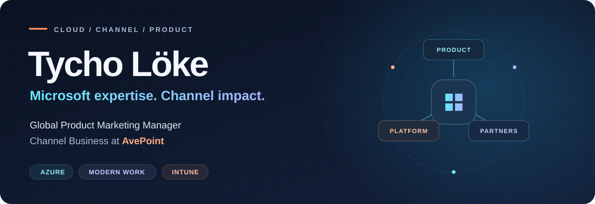

  

  
  &nbsp;
  
  &nbsp;
  

 

### Turning technical depth into a clear product story.

I'm **Tycho**, Global Technical Product Marketing Manager, Channel at **AvePoint**, with expertise in **Microsoft Azure, Modern Work, and Intune**.

I connect hands-on Microsoft experience with product positioning, partner enablement, and practical technical content—helping partners understand the platform, explain its value, and put it to work.

 

<table>
  <tr>
    <td valign="top" width="33%">
      <b>01 / PRODUCT &amp; CHANNEL</b>
      <h3>Make the value clear.</h3>
      
Product positioning, technical storytelling, and enablement for partners and MSPs.

      POSITIONING · PARTNER ENABLEMENT
    </td>
    <td valign="top" width="33%">
      <b>02 / MICROSOFT CLOUD</b>
      <h3>Know the platform.</h3>
      
Azure infrastructure, Microsoft 365, Modern Work, identity, and governance.

      AZURE · MICROSOFT 365 · ENTRA
    </td>
    <td valign="top" width="33%">
      <b>03 / ENDPOINT &amp; AUTOMATION</b>
      <h3>Keep it practical.</h3>
      
Intune, Windows configuration, and useful automation with PowerShell and Microsoft Graph.

      INTUNE · POWERSHELL · GRAPH
    </td>
  </tr>
</table>

 

### Technical perspective. Commercial clarity.

My work sits where **product, partners, and technology** meet. I bring a builder's perspective to product marketing, grounding the story in real use cases and hands-on experience.

| Technical foundation | Channel application |
| :--- | :--- |
| **Azure & Azure Virtual Desktop** | Practical cloud scenarios and technical demos |
| **Microsoft 365 & Modern Work** | Collaboration, identity, and governance stories |
| **Intune & Windows** | Endpoint management use cases and enablement |
| **PowerShell & Microsoft Graph** | Repeatable demos, reporting, and admin automation |

 

> **Behind the scenes** &nbsp; My project repositories are private while I refresh the portfolio. This profile stays open for ideas, connections, and conversations.

 

  <b>Let's talk Microsoft cloud, partner enablement, and product marketing.</b>  
  <a href="https://www.linkedin.com/in/tycholoke/">LinkedIn</a> &nbsp; / &nbsp;
  <a href="https://tycholoke.com">Website</a>

Based in the Netherlands · Global channel focus Personal projects and views are my own.

